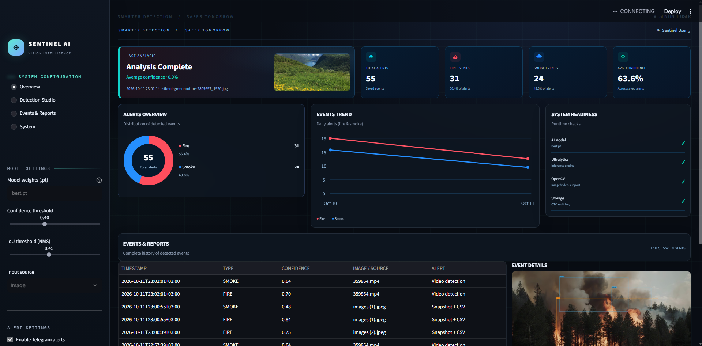

# SENTINEL AI — Fire & Smoke Detection

**An AI-powered fire and smoke detection system using Deep Learning, YOLOv8, and Computer Vision.**

SENTINEL AI is a computer vision project designed to detect fire and smoke in images and videos using a trained YOLO object detection model. The project integrates an interactive Streamlit dashboard to make detection, result visualization, and event monitoring accessible through a user-friendly interface.

## Dashboard Preview



## Overview

Early fire and smoke detection can help improve situational awareness and support faster responses to potential hazards.

SENTINEL AI explores how Deep Learning and object detection can be applied to this challenge by combining a trained YOLO model with an interactive application for analyzing visual input and reviewing detection results.

## Key Features

* **Fire Detection:** Identify potential fire instances in images and videos.
* **Smoke Detection:** Detect visible smoke using a trained object detection model.
* **Image Analysis:** Upload images and visualize detection results.
* **Video Analysis:** Analyze video input and display detection results.
* **Bounding Box Visualization:** Display detected objects with bounding boxes and model predictions.
* **Interactive Dashboard:** Use a Streamlit interface to interact with the system.
* **Event Logging:** Record detection events for later review.
* **Telegram Notifications:** Optional alert integration when properly configured.

## Technology Stack

| Technology  | Purpose                                 |
| ----------- | --------------------------------------- |
| Python      | Core application development            |
| YOLOv8      | Object detection                        |
| Ultralytics | YOLO model integration                  |
| OpenCV      | Image and video processing              |
| Streamlit   | Interactive web dashboard               |
| NumPy       | Numerical operations                    |
| Pandas      | Data handling and event records         |
| Pillow      | Image handling                          |
| Requests    | Optional Telegram notification requests |

## Project Structure

```text
SENTINEL-AI-Fire-Smoke-Detection/
├── app_sentinel_dashboard.py
├── best.pt
├── requirements.txt
├── README.md
├── .gitignore
├── streamlit/
│   └── config.toml
└── alerts/
    ├── logs/
    ├── snapshots/
    └── processed_videos/
```

*Note: The directory structure shown above represents the intended organization. Some runtime files and directories may be created automatically when the application runs.*

## Getting Started

### Prerequisites

* Python 3.10 or a compatible Python version supported by the project's dependencies.
* pip package manager.
* The trained YOLO model weights file, `best.pt`.

### 1. Clone the Repository

```bash
git clone https://github.com/omarHashiim/SENTINEL-AI-Fire-Smoke-Detection.git
cd SENTINEL-AI-Fire-Smoke-Detection
```

### 2. Create a Virtual Environment

```bash
python -m venv venv
```

Activate it on Windows PowerShell:

```powershell
.\venv\Scripts\Activate.ps1
```

### 3. Install Dependencies

```bash
python -m pip install --upgrade pip
pip install -r requirements.txt
```

### 4. Verify Model Availability

Make sure `best.pt` is present in the location expected by the application. The application needs access to the trained model to perform detection.

### 5. Launch the Dashboard

```bash
python -m streamlit run app_sentinel_dashboard.py
```

Open the local URL displayed in the terminal to access the Streamlit dashboard.

## Configuration

Some features may require additional configuration:

* **Model Path:** Ensure the application points to the correct `best.pt` file.
* **Telegram Alerts:** Configure the required Telegram credentials if notifications are enabled.
* **Runtime Directories:** The application may need permission to create or write detection logs, snapshots, and processed video files.

Never commit API tokens, bot credentials, passwords, or other secrets to a public repository.

## Current Scope and Limitations

* Detection quality depends on the training data, model performance, and input image or video quality.
* Performance may vary under different lighting, visibility, and environmental conditions.
* Real-time camera support depends on the application's implemented functionality and the available hardware.
* The project is an educational prototype and is not a substitute for certified fire detection or emergency response systems.

## Project Context

SENTINEL AI was developed as part of a Deep Learning team project focused on applying computer vision to fire and smoke detection.

The project brings together model inference, visual result presentation, application development, and detection event monitoring in a single interface.

## Future Improvements

Potential directions for further development include:

* Evaluating model performance using Precision, Recall, and mAP.
* Improving robustness across different environmental conditions.
* Expanding detection event analytics and reporting.
* Enhancing real-time monitoring and alert workflows.
* Optimizing inference speed and application deployment.

## Disclaimer

SENTINEL AI is an educational and demonstration project. It must not be relied upon as the sole method of fire detection, emergency notification, or life-safety protection.
